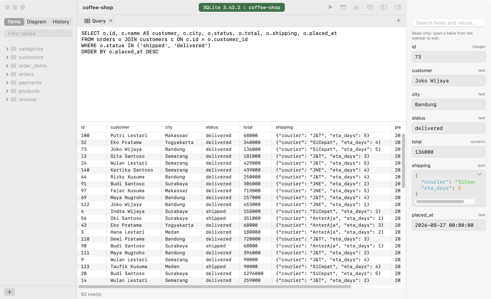
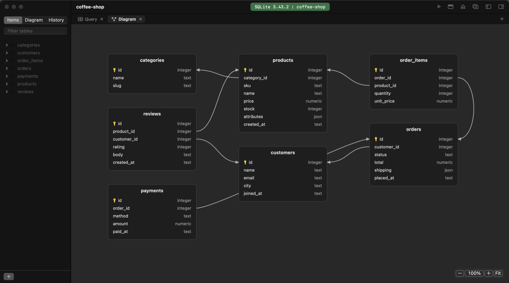
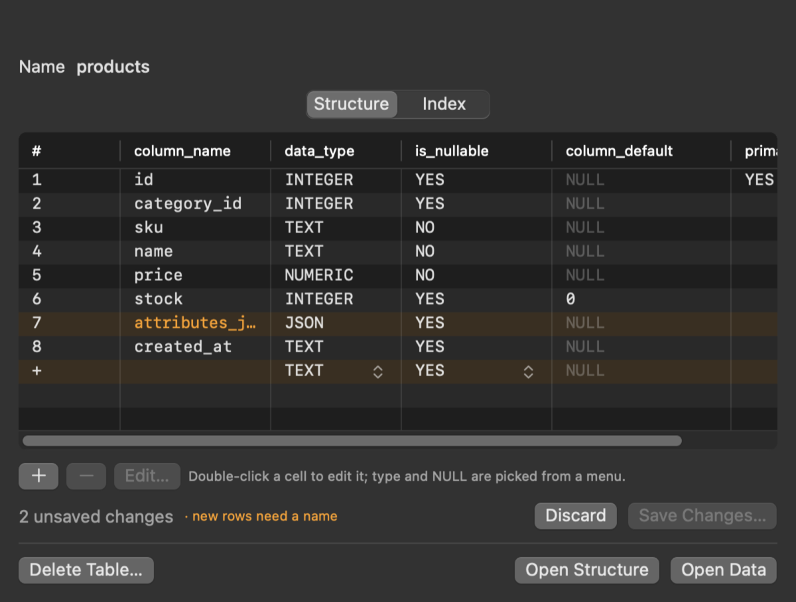

<p align="center">
  
</p>

<h1 align="center">Kueri</h1>

<p align="center">
  A small, native macOS client for PostgreSQL, MySQL/MariaDB, SQLite and Redis.<br>
  Swift, AppKit and SwiftUI. No Electron, no bundled runtime: the whole app is a few megabytes.
</p>

<p align="center">
  <a href="https://github.com/agungkristd/Kueri/releases/latest"><b>Download for macOS</b></a>
  &nbsp;·&nbsp; macOS 14.4 or later &nbsp;·&nbsp;
  <a href="#build-from-source">Build from source</a>
</p>

<picture>
  <source media="(prefers-color-scheme: dark)" srcset="docs/grid-dark.png">
  
</picture>

## What it does

### Browse and edit data

- A native grid that stays fast with hundreds of columns and thousands of rows, 300 rows per page.
- Double-click a cell to edit it; changed rows are tinted until you save them by primary key (⌘S).
  Results of a hand-written `SELECT * FROM one_table …` are editable too.
- Delete one or several rows (⌘- or ⇧-click, then Delete), after a confirmation.
- Click a column header to sort; the query is rewritten to `ORDER BY` that column, ascending then
  descending.
- Foreign-key cells have an arrow that opens the referenced table, filtered to that row.
- A row details panel: every field of the selected row, with search. Enum and boolean columns are
  pickers, JSON is shown formatted in an editor (Pretty / Minify), long values get a one-click
  Show all, and each field has a menu to copy it, set it NULL or empty, or revert it.
- ⌘Z and ⇧⌘Z undo and redo unsaved edits, whether made in the grid or in the details panel.
- Tables, structure views and diagrams open side by side in tabs; every connection gets its own
  window tab (⌘T), and tabs reconnect after a restart. Drag connections to reorder them.
- A connection bar shows server version, connection, database and table, in red for production.
- When the server goes away (sleep, a Wi-Fi change, a restart) a banner offers Reconnect; tabs,
  results and unsaved edits stay as they were.

### Write queries

- SQL editor with inline completion for keywords, tables and columns (Tab accepts, ⌥Esc lists them).
- Query history per connection and database, grouped by day, in the sidebar (⌘Y).
- Templates for databases, tables, views, materialized views, functions and schemas.

### See the schema



- A foreign-key diagram of one table and its neighbours, or of the whole database from the
  sidebar's Diagram tab. Drag tables to arrange them, drag empty space to scroll, zoom with
  ⌃-scroll, pinch or ⌘= / ⌘− / ⌘0.
- Double-click or right-click a table for its details:

<p align="center"></p>

- Columns and indexes are edited in the grid like a spreadsheet: add a row, rename, pick the type,
  NULL, algorithm or index columns from a menu, delete. Nothing runs until you save, and the SQL is
  shown first. SQLite can only rename existing columns.

### Manage databases

- Create databases and schemas from the sidebar's **+** menu.
- **Database Owner…** (PostgreSQL) hands the open database to another role together with every
  schema, table, view, sequence, function and type in it, in one transaction.

### Move data

- Export a whole database, its structure or its data; import into the same or another server:
  - **PostgreSQL** in every pg_dump format: SQL (`.sql`), custom (`.dump`, `.bak`), tar (`.tar`) and
    directory. The format is read from the file, so a `.backup` or a renamed archive works too.
    Dumps move between server versions in both directions (tested 12 ↔ 17). TimescaleDB dumps are
    restored in TimescaleDB's restore mode, or refused before any change when the target lacks it.
  - **MySQL/MariaDB** with a built-in dumper (tested MySQL 8.4 → MariaDB 11).
  - **SQLite** with `sqlite3` (`.dump`, or the database file itself as `.bak`).
- An import with failed statements reports them, grouped, instead of reporting success.

### Stay safe on servers that matter

- TLS for every server type: Off, Prefer, Required (self-signed is fine) or Verify.
- SSH tunnels through the system `ssh`, so your `~/.ssh/config`, keys and ssh-agent apply.
- Production mode asks before UPDATE/DELETE without WHERE, DROP, TRUNCATE, saves and imports.
- Server processes (⇧⌘P): see every client connection, cancel a query or kill a connection.

### Make it yours

Settings (⌘,) holds the theme (System, Light, Dark), the grid and editor font with a preview, rows per page,
the result row limit, a server-side query timeout, startup behaviour, history privacy and a
keymap where every shortcut can be changed.

## Install

1. Download `Kueri-<version>.dmg` from the [latest release](https://github.com/agungkristd/Kueri/releases/latest).
2. Open it and drag **Kueri** to **Applications**.
3. Kueri isn't notarized by Apple, so the first launch is blocked. Open **System Settings ›
   Privacy & Security** and click **Open Anyway**, or run once:

   ```sh
   xattr -dr com.apple.quarantine /Applications/Kueri.app
   ```

The DMG carries everything it needs, including `pg_dump`, `pg_restore` and `psql` for PostgreSQL
export and import. It's built for Intel Macs and runs on Apple silicon through Rosetta.

## Build from source

Requirements: macOS 14.4+, Xcode Command Line Tools (Swift 5.9+), and `brew install libpq openssl@3`.
MySQL/MariaDB and Redis use built-in protocol implementations and need no client libraries.

```sh
./build.sh                       # Kueri.app in this folder
cp -R Kueri.app /Applications/   # optional
./package.sh                     # self-contained Kueri-<version>.dmg
```

`build.sh` signs with a code signing identity named "Kueri Local Signing" when your keychain has
one (Keychain Access › Certificate Assistant › Create a Certificate…, type Code Signing), or with
`KUERI_SIGN_IDENTITY`; otherwise ad-hoc. A stable identity keeps macOS permissions such as Local
Network across rebuilds; with ad-hoc signing every build is a new app to macOS.

For PostgreSQL archives compressed with zstd or lz4, install a full PostgreSQL client (for example
Postgres.app); Kueri prefers it over libpq, which only reads gzip-compressed archives.

### Checks

```sh
swift build -Xcc -I"$(brew --prefix libpq)/include" -Xlinker -L"$(brew --prefix libpq)/lib" \
  -Xcc -I"$(brew --prefix openssl@3)/include" -Xlinker -L"$(brew --prefix openssl@3)/lib"
.build/debug/Kueri --selftest            # driver and logic checks (debug build: they are asserts)
Kueri.app/Contents/MacOS/Kueri --bench   # grid performance and UI behaviour checks
```

`--probe <sqlite|postgres|mysql|redis> host port user password database "query"` runs a query
against a server from the command line, which is handy when working on a driver.

## License

Kueri is open source under the [MIT License](LICENSE). The release DMG also contains libpq and the
PostgreSQL client tools, OpenSSL and MIT Kerberos under their own permissive licenses; see
[THIRD_PARTY_NOTICES.md](THIRD_PARTY_NOTICES.md).

## Limitations

- Saved passwords are stored unencrypted in the app's preferences file
  (`~/Library/Preferences/app.kueri.plist`, readable only by your user account), not in the Keychain.
- For MySQL 8 servers that require full `caching_sha2_password` authentication, use TLS Verify, or
  enable "Allow public key retrieval" on the connection. It is off by default, because without a
  verified certificate the password or the server's key could be intercepted on the network.
- PostgreSQL refuses servers that ask for the password in clear text (`require_auth=!password`);
  scram, md5 and trust work as usual. Enable "Allow cleartext password" only for servers that use the
  `password` auth method on a trusted network.
- Without TLS Verify or an SSH tunnel, Redis passwords are only sent to localhost. For a server
  elsewhere on a trusted network, enable "Allow cleartext password".
- SQL files are imported with `psql` in restricted mode and `sqlite3 -safe`, so meta-commands in a
  file (`\!`, `.shell`, …) are refused and reported as errors.
- TimescaleDB restores need the same TimescaleDB version on the target as on the source server.
- Queries that mention passwords or authentication (`password`, `AUTH`, `IDENTIFIED BY`, …) are
  not saved to the query history.
- Result sets are capped in memory (10,000 rows by default, see Settings). Postgres streams rows, so
  large results don't exhaust memory.
- The result filter (⌘F) searches the rows already loaded (the current page or result), not the
  whole table; use a WHERE clause for that.
- Syntax colours are skipped for SQL longer than 200 KB, to keep the editor responsive.
- The query timeout applies to PostgreSQL and MySQL (SELECT only), not to SQLite or Redis, and to
  connections opened after it's set.
- Redis values are read-only.
- Editing, deleting rows and sorting by header work on a table opened from the sidebar or a
  `SELECT * FROM one_table` with at most WHERE, ORDER BY, LIMIT and OFFSET; joins, column lists and
  other queries are read-only. Edits and deletes also need the table's primary key in the result.
- Deleting several rows runs one DELETE per row, not in a transaction; a failure part-way leaves
  the rows before it deleted.
- A foreign key over several columns is followed by the clicked column only.
- The release DMG is built for Intel Macs (Apple silicon runs it through Rosetta) and isn't notarized,
  so macOS asks you to allow it once (see [Install](#install)).
- The `pg_restore` bundled in the DMG reads gzip-compressed archives only; for zstd or lz4 archives,
  install Postgres.app or Homebrew PostgreSQL, which Kueri then prefers.
- The whole-database diagram shows up to 150 tables (the current schema).
- Existing indexes can be deleted but not edited in place; delete and add one instead.
- SQLite columns can be renamed, added and deleted, but not retyped (SQLite needs the table rebuilt).
- Server processes are listed over the tab's own connection, so the list waits while that tab is
  running a long query (use Stop for the tab's own query).
- A connection that silently died is detected within about 25 seconds on PostgreSQL (TCP
  keepalives); on MySQL and Redis the next query reports it.
- Database Owner… works on the database you are connected to and leaves objects that belong to an
  extension with the extension.
- Undo covers unsaved edits only; saving, discarding or switching tabs clears the undo history.
